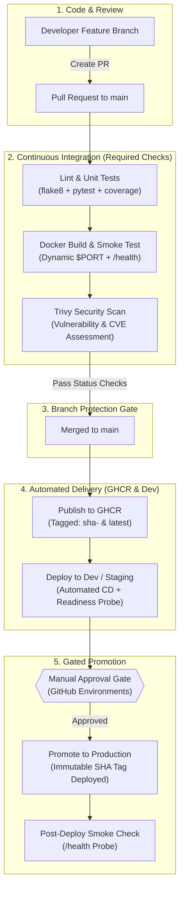

# URL Shortener with Production-Grade CI/CD Pipeline

[](https://github.com/KrishnakantYadav00/cicdintegratedshortner/actions/workflows/ci.yml)
[](https://github.com/KrishnakantYadav00/cicdintegratedshortner/pkgs/container/cicdintegratedshortner)
[](https://www.python.org/)
[](https://www.sqlite.org/)
[](https://aquasecurity.github.io/trivy/)

A resilient URL Shortener built in Python/Flask, engineered specifically as a showcase for modern **DevOps, Continuous Integration, Automated Container Security Scanning, and Gated Continuous Delivery**.

---

## 🏗️ Architecture & Pipeline Overview



---

## ⚡ Core Features

- **Fast URL Shortening:** Generates unique, collision-resistant 6-character alphanumeric slugs with automatic retry.
- **Custom Vanity Slugs:** Supports custom short codes (3-16 alphanumeric characters, dashes, and underscores) with collision detection (HTTP 409).
- **URL Sanitation & Validation:** Scheme validation (`http://` / `https://`) with regex guards.
- **Click Analytics:** Atomic click increment counter on every redirect (HTTP 302).
- **Deep Health Probe (`/health`):** Verifies both web server responsiveness and active database connectivity.
- **Database Agnostic:** Runs out of the box with zero configuration using **SQLite** (with `/data` persistent volumes) or enterprise **PostgreSQL** via `DATABASE_URL`.
- **Cloud-Ready Container:** Automatically respects host-injected `$PORT` (compatible with Render, Cloud Run, AWS ECS, Fly.io, and Railway).

---

## 🛠️ Local Development & Quickstart

### Native Python

```bash
# Clone the repository
git clone https://github.com/KrishnakantYadav00/cicdintegratedshortner.git
cd cicdintegratedshortner

# Create and activate virtual environment
python -m venv .venv
source .venv/bin/activate  # On Windows: .venv\Scripts\activate

# Install development dependencies
pip install -r requirements-dev.txt

# Verify your development environment
python check_deps.py

# Run test suite with coverage
pytest tests/ -v --cov=app

# Start development server
python app.py
# → Access at http://localhost:5000
```

### Docker & Docker Compose

Run the entire application stack with a single command:

```bash
# Start container with persistent SQLite volume at /data
docker compose up --build

# Verify container health
curl http://localhost:5000/health
```

To run with **PostgreSQL**:
```bash
docker compose -f docker-compose.prod.yml up --build
```

---

## 📡 API Specification

| Method | Endpoint | Description | Payload Example |
|---|---|---|---|
| `POST` | `/api/shorten` | Shorten a target URL | `{"url": "https://github.com", "custom_code": "git"}` |
| `GET` | `/<code>` | Redirects to original URL (302) | *None* |
| `GET` | `/api/stats/<code>` | Returns click counts and timestamps | *None* |
| `GET` | `/health` | Deep liveness/readiness probe | *None* |
| `GET` | `/` | Web UI for manual shortening | *None* |

---

## 🔒 CI/CD & Protection Mechanics

### 1. Branch Protection Enforcement
The `main` branch is protected by strict repository rulesets:
- Requires passing **Lint & Unit Tests** (`flake8` + `pytest`).
- Requires passing **Docker Build & Vulnerability Scan** (`Trivy`).
- Requires branches to be fully up-to-date before merging.
- Prevents force pushes and branch deletions.

To configure branch protection via GitHub CLI:
```bash
# Linux/macOS
./scripts/setup_branch_protection.sh

# Windows PowerShell
.\scripts\setup_branch_protection.ps1
```

### 2. Trivy Image Security Scanning
Every pull request builds the Docker image and runs an Aqua Security Trivy vulnerability scan checking for `CRITICAL` and `HIGH` CVEs before code can be merged.

### 3. Container Registry Publishing (GHCR)
Upon merge to `main`, GitHub Actions authenticates against `ghcr.io` and publishes immutable image tags:
- `ghcr.io/krishnakantyadav00/cicdintegratedshortner:latest`
- `ghcr.io/krishnakantyadav00/cicdintegratedshortner:sha-<short_commit_sha>`

### 4. Gated Promotion to Production
- **Dev/Staging:** Automatically deployed upon merge to `main`.
- **Production:** Configured with GitHub Environments (`production`). Deploys the **exact identical tested container SHA tag** only after authorized team approval.

---

## 🧪 DevOps Case Studies

### Case Study A: The Deliberately-Broken PR (Blocked by CI)
1. A developer opens a PR that introduces a syntax error, fails URL validation tests, or adds a vulnerable base image.
2. The GitHub Actions matrix triggers automatically:
   - `test` job runs `pytest` → **fails with non-zero exit code**.
   - `build-and-scan` job detects unhandled errors.
3. GitHub branch protection blocks the "Merge" button.
4. **Result:** Broken code cannot reach `main` or production.

### Case Study B: Zero-Downtime Rollback
1. If an unexpected production issue occurs after promotion:
2. Navigate to GitHub Actions or target environment.
3. Re-deploy the previously known-good container tag (e.g., `ghcr.io/...:sha-abc1234`).
4. The healthcheck probe (`/health`) ensures zero dropped requests during container replacement.
